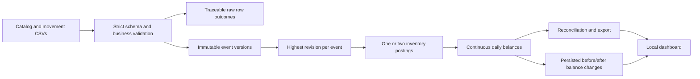

# Stock Invento

A locally runnable inventory data pipeline that turns receipts, issues, transfers, and signed adjustments into daily balances. It preserves event revisions, rebuilds historical balances after corrections, reconciles published quantities, and makes rejected rows and failed runs inspectable. Version 1.1 adds browser CSV imports, persisted before/after correction impact, and a dashboard section showing the recorded verification evidence.

Python 3.10+ is the compatibility minimum; use a currently supported release for a new installation. The standard library is sufficient: no external accounts, API keys, hosted services, third-party Python packages, Node.js, or npm are required. Official installation links are in the [portable setup guide](docs/portable-setup.md).

The local demo login is **username `admin` / password `admin123`**, also printed prominently in `START_HERE.txt`. Start the server, then open [the local login page](http://127.0.0.1:8765/login), using your selected port if different. These are shared demonstration defaults rather than private account credentials.

The top-right **Sign out** action ends the current session. Sign in again after a server restart, thirty idle minutes, or eight hours from login. An existing workspace keeps its chosen password; stop the server and use `python3 -m inventory set-password --db var/demo/inventory.db` from the project root to change it, then restart. Substitute your selected database path. The [portable guide](docs/portable-setup.md) explains password changes and recovery.

## Review on another laptop

Clone this repository or extract its complete source ZIP, then read `START_HERE.txt` or the detailed [portable setup and troubleshooting guide](docs/portable-setup.md). With Python 3.10+ installed, run `python3 run_demo.py` from the extracted folder (Windows: `py -3 run_demo.py`). The included Windows, macOS, and Linux launchers start the same app. No package downloads, GitHub upload, API keys, or external account setup are needed. The demo creates its local database and opens the browser after the server starts; sign in with `admin` / `admin123`. Use `--no-browser` to open the printed URL yourself, or `--port 8766` if the default port is busy.

Stop with `Ctrl+C`; restart preserves the existing database. For a clean review without deleting saved data, use `python3 run_demo.py --data-dir var/final-review --port 8766` with an unused folder. Relative `--data-dir` paths start at the project folder, even when invoking the script from another directory; absolute and `~` paths are supported. An absolute path to `run_demo.py` works from any working directory. The module commands below run from the project root.

## Run the demonstration

From this repository's root:

```sh
python3 --version
python3 -m inventory demo --out var/demo
python3 -m inventory serve --db var/demo/inventory.db --port 8765
```

Open [the local dashboard](http://127.0.0.1:8765) and sign in at its local login page. Stop the server with `Ctrl+C`. You can inspect the ledger or preview and explicitly import movement CSVs through the dashboard; the CLI remains available for the same ingestion workflow.

The dashboard uses a green theme and opens at **Inventory overview**. The main header's **Import CSV** button opens the import drawer. The sidebar links to **Overview**, **Inventory ledger**, and **Verification**, with **View process guide** below. **Process guide** and **Achievements & verification** are together below the ledger and start collapsed; **Verification** opens achievements.

Expand the **Seeded demo** and **Review required** headings below the metric cards when present to read their details. The import guidance headed **Valid rows commit. Invalid rows go to quarantine.** also starts collapsed; select its heading to read the explanation.

The fresh default demo loads **exactly 50 distinct, valid revision-1 movement records** from `data/demo/movements.csv`, covering five items (ITEM-A–ITEM-E), three locations (WH-A–WH-C), all four movement types, and January 1–4. It applies the separate backdated receipt correction, then seeds transfer cancellation/restoration, quarantine, and failure/recovery examples. The resulting fresh ledger has **50 current events, 53 historical versions, 47 daily balance rows, and four intentionally negative closing rows**. Three deliberately invalid example rows are quarantined separately from the 50 valid movement records; seven scenario attempts appear in **Pipeline runs**. Restarts and later imports add audit attempts. Demo reports are written to `var/demo/export` by default, or `<data-dir>/export` when a different folder is selected.

If you ran an earlier demo, use a new data folder to see the updated negative-stock examples. Existing immutable revision-1 quantities are preserved; restarting an old database does not overwrite them and can report conflicts against the updated source. Keep that database and choose an unused folder for the current baseline.

In **Process guide**, **Demo movements CSV · 50 records** downloads that same default source. Its item and location catalog downloads contain the matching five items and three locations. These files are served under `/api/demo/`; the original seven-event files remain available locally in `data/sample` and through the unchanged `/api/sample/` endpoints.

The original seven-event fixture remains in `data/sample`, with independent hand-calculated answers in `data/expected`. The larger default demo preserves those original events and adds 43 events only for ITEM-C, ITEM-D, and ITEM-E. On January 4, ITEM-A at WH-A still closes at `65.000` before the revision-2 correction and `75.000` afterward; ITEM-A at WH-B remains `24.500`, and ITEM-B at WH-A remains `10.000`.

## Explore the seeded examples

Each of the six ledger tabs has a **Demo example** drop-down, collapsed by default. Expand it to see the note and any example action. These examples and the bottom **Process guide** use actual recorded runs to explain each view:

| View | What the fresh demo demonstrates |
| --- | --- |
| Daily balances | 47 derived item/location/day rows from 50 current movements, including four intentional negative closings |
| Correction impact | The backdated receipt correction and cancellation/restoration of `demo-c-transfer-1`, with retained before/after quantities |
| Reconciliation | Accepted current movements reconcile even though three separate source examples were rejected |
| Pipeline runs | One deliberately failed schema example followed by a successful replay identifying all 50 source events as duplicates |
| Quarantine | Four-decimal quantity precision, an unknown item, and a transfer whose source equals its destination |
| Event history | 53 immutable versions, including the superseded and restored transfer versions |

The named example failure is a historical input-schema demonstration, not a failed browser server. After completed setup, the seed marker adds these extra examples only once per database, preserving user data and preventing repeated startup from accumulating the same bad examples. Manually importing an example file records another normal attempt. Unexpected errors from later imports still need normal investigation; only the supplied example files and their recorded runs are intentional.

In **Daily balances**, expand **Demo example**, then select **View this example** to focus ITEM-A/WH-A for January 1–4. **Close example** restores the previous filters and page; manually changing a filter exits the example and keeps your new choice. The example view does not import or change inventory.

To inspect negative stock, filter ITEM-D/WH-C on January 2–4 (`-9.875`, `-14.000`, `-14.000` KG) or ITEM-E/WH-B on January 4 (`-3.625` L). These are four item/location/day rows across two series, not four distinct calendar dates. The underlying issue movements are valid and accepted: negative stock is a warning, separate from quarantine. Arithmetic reconciliation still passes. See [the demo data notes](data/demo/README.md) for the source quantities; later user-data warnings still need normal review.

## Import and inspect corrections in the browser

Open **Import CSV** in the main header, choose a movement CSV in the drawer, inspect the preview, optionally set an inclusive reporting date, and select the explicit import action. Close (×) or `Escape` dismisses the drawer; reopening retains the draft while the page stays open. The preview does not publish inventory. Import uses the same server-side validation, revision policy, quarantine, atomic publication, and audit trail as the CLI. Valid rows can publish while invalid rows are quarantined; inspect the returned counts and reject reasons.

Items and locations must exist before movement import. The optional catalog upload accepts item and location CSVs as a separate atomic step. A later failed movement import does not undo previously added catalogs, and an existing item's unit cannot be silently changed.

After import, **View this run’s balance impact** closes the drawer and opens that run in **Correction impact**. You can also choose a successful run there to compare each affected item/location/day before and after publication. It shows added and removed rows, exact closing quantities, closing deltas, and changed movement fields. A replay that leaves business balances unchanged records a new operational run with zero balance changes. Failed imports create no published changes. Runs created before version 1.1 have no captured comparison history.

The bundled demo already applies `corrections.csv` revision 2. Open **Process guide** below the ledger and select **Download correction**. Then open **Import CSV**, choose the downloaded `review_correction.csv`, and select **Import & publish**. On a fresh standard demo, its revision 3 raises the receipt from `110.000` to `120.000` and the January 4 ITEM-A/WH-A closing from `75.000` to `85.000`. Reimporting the same file demonstrates safe duplication. The result depends on the versions already in your database. See [the walkthrough](docs/walkthrough.md) for this exercise and the original revision-2 correction on a fresh starter database.

## Run each step with the seven-event fixture

These commands use the smaller test fixture for easy hand verification. The `demo` command above uses the separate 50-event dataset.

```sh
python3 -m inventory init --db var/inventory.db \
  --items data/sample/items.csv --locations data/sample/locations.csv

python3 -m inventory run --db var/inventory.db \
  --input data/sample/movements.csv --through 2026-01-04

python3 -m inventory run --db var/inventory.db \
  --input data/sample/corrections.csv --through 2026-01-04

python3 -m inventory report --db var/inventory.db
python3 -m inventory export --db var/inventory.db --out var/export
python3 -m inventory serve --db var/inventory.db --port 8765
```

A run exits `0` on success, `2` when valid rows were published and invalid rows quarantined, and `1` on a fatal error. The larger generated data deliberately includes invalid and duplicate rows, so its ingestion normally exits `2`. Inspect its summary before continuing; do not interpret that exit code as a rolled-back load.

Run tests and generate a larger, reproducible source batch:

```sh
python3 scripts/run_tests.py --out var/test-results-new
python3 -m inventory generate --out var/generated --rows 100000 --seed 42
python3 -m inventory init --db var/large.db \
  --items var/generated/items.csv --locations var/generated/locations.csv
python3 -m inventory run --db var/large.db --input var/generated/movements.csv
python3 -m inventory export --db var/large.db --out var/large-export
```

Run summaries include duration and row counts. Use the same seed, Python version, machine, and storage when comparing performance. The larger generator varies item, movement type, and location independently so the 100,000-row batch covers every movement type for every item. It writes `coverage.json` separately from movement inputs to make observed coverage inspectable.

The dashboard's **Achievements & verification** disclosure is below the ledger and starts collapsed. Select **Verification** in the sidebar to open it. It displays recorded benchmark results and implemented capabilities separately from the live ledger above. Benchmark timings describe the recorded workload and environment, rather than the current small demo or an assumed speed improvement. See `evidence/` for the actual measurement and verification results. Regenerate those artifacts with:

```sh
python3 scripts/verify.py --rows 100000 --out evidence
```

The latest [rigorous 100,000-row run](evidence/rigorous/performance.json) took **4.83 seconds** on arm64 macOS with Python 3.14.6, including validation, audit/history writes, a full rebuild, reconciliation, retained balance comparisons, and commit. It accepted 98,230 event versions, identified 990 duplicates, quarantined 780 deliberate invalid rows, and published 71,839 daily rows. All 100 generated items covered all four movement types and all eight source locations. All fifteen reconciliation checks passed; replay preserved the business output and recorded zero balance changes. The [older 4.60-second measurement](evidence/performance.json) is retained as historical evidence. These individual runs are not a measured speedup comparison or a capacity guarantee.

Exports include `daily_balances.csv`, `runs.csv`, `reconciliation.csv`, `raw_records.csv`, `movement_versions.csv`, `postings.csv`, `balance_changes.csv`, and `report.json`. Daily quantities use decimal strings; event/posting audit exports retain explicitly named `_milli` integer columns. The change audit stores its integer-thousandths closing delta as decimal integer text to preserve deltas wider than SQLite's signed 64-bit range. The dashboard and JSON report display the most recent 500 rejected rows and movement versions; the CSV audit exports contain all rows. Correction comparisons are available through the paginated changes API.

## How it works



Publishing event versions, postings, daily balances, and their before/after change records uses one SQLite transaction. Invalid individual records enter quarantine while valid records can publish. A structural CSV error or a fatal publish error fails the batch without publishing its new inventory state or changes; the failed run remains visible for diagnosis.

For each item, location, and day:

```text
closing = opening + receipts - issues + transfers_in - transfers_out + adjustments
```

A transfer creates equal source and destination legs in the same transaction. Every location starts at zero before its first effective movement. Subsequent days carry the previous closing quantity, including days with no movements.

## Input contract and correction policy

The movement CSV has exactly these column names; their order may differ:

```csv
event_id,revision,effective_date,movement_type,item_id,location_id,to_location_id,quantity,is_void
```

- `event_id` is a stable source identifier; `(event_id, revision)` identifies an immutable version.
- `revision` is a positive integer. The highest valid revision wins, even when files arrive out of order.
- A correction supplies the complete replacement event with a higher revision. To cancel an event, supply a higher revision with `is_void=true` and its complete event payload.
- Replaying an identical normalized version is a duplicate with no additional inventory effect. Different contents under the same version key are quarantined as a conflict.
- `effective_date` is a strict `YYYY-MM-DD` business date. Operational timestamps are separate UTC ISO-8601 timestamps.
- `movement_type` is `RECEIPT`, `ISSUE`, `TRANSFER`, or `ADJUSTMENT`. Receipts, issues, and transfers use positive quantities; adjustments use signed, nonzero quantities.
- Quantities use at most three decimal places and an absolute maximum of 1,000,000,000 units per event. They are stored as integer thousandths; no binary floating-point arithmetic determines inventory.
- Items and locations must already exist in the catalogs. Transfers require a different known destination; other movement types require a blank destination.

The full schema, nullability, keys, lineage, and field meanings are documented in [the data dictionary](docs/data-dictionary.md).

## Assumptions and trade-offs

- One inventory unit is defined per item. Unit conversion, lot/serial tracking, reservation, valuation, transit duration, and monetary accounting are outside this implementation.
- A transfer happens at both locations on its effective date. There is no separate in-transit warehouse unless represented explicitly in the input catalog and movements.
- Negative balances are published and flagged for review. Rejecting them would hide useful data-quality evidence and requires a business policy not supplied here.
- Opening stock is represented by a dated receipt or signed adjustment. There is no implicit external opening snapshot.
- Every successful load recomputes the current ledger and balances. This favors understandable correction behavior over a more complex incremental algorithm. An affected item/location/date rebuild is the next optimization if measurements justify it.
- Changed daily snapshots are retained per successful run. This makes correction effects inspectable at the cost of additional audit storage. Changes compare business quantities and row presence, excluding publication lineage alone. Compare within an item's unit and one date; adding deltas across different items or multiple days does not represent a stock balance.
- The output horizon is the latest of the supplied `--through` date, current effective dates, and the previous published horizon. Corrections can remove obsolete leading rows when a series' first effective movement changes.
- SQLite supports the local single-writer workflow. A single local admin login gates HTTP access; multi-user roles, scheduling, distributed processing, and production service hardening are outside this implementation. Local files and CLI commands remain accessible to the operating-system user.
- Browser imports are local only. Mutating requests require the local server's session, token, and origin checks. Password hashes use a per-workspace random salt and PBKDF2-HMAC-SHA256 with 600,000 iterations. Sessions use `HttpOnly`, `SameSite=Strict` cookies; plain loopback HTTP means no `Secure` cookie flag. See the [authentication design](docs/design.md#local-usernamepassword-authentication) for scope and limits.
- Each browser CSV is limited to 10 MiB and each import JSON request to 32 MiB; login/logout bodies are limited to 8 KiB. Use the CLI for larger files. The preview displays the first six physical lines; import performs authoritative validation of the complete CSV.

See [portable setup, backup, and troubleshooting](docs/portable-setup.md), [design and recovery behavior](docs/design.md), [the review walkthrough](docs/walkthrough.md), and [the submission checklist](docs/submission-checklist.md). Browser **Export view** saves the filtered balances; CLI `export` saves a consistent analysis/audit snapshot. For preserving a full database, follow the portable guide's SQLite backup instructions rather than copying a live `.db` file alone.

## Verification and AI disclosure

The [final package review](docs/final-review.md) records a fresh extracted-ZIP run: **117 Python methods / 222 subtest checks**, **11 JavaScript checks**, independent sample oracles, and a fresh **100,000-record** reconciliation/replay check passed. Its [per-test source hashes](evidence/final-review/python-tests.json) identify the verified runtime and tests.

The **authentication feature campaign** passed **117 Python test methods containing 222 recorded subtest checks**, with zero failures/errors/skips, in 11.136807 seconds. Eleven optional JavaScript helper checks and both browser-script syntax checks passed. Eight real-browser scenarios covered sign-in, wrong credentials, password visibility, authenticated CSV correction, sign-out, browser Back after sign-out, and retained data after signing in again. See the [authentication test report](docs/auth-test-report.md), [per-test JSON](evidence/authentication/python-tests.json), [JUnit XML](evidence/authentication/junit.xml), [full log](evidence/authentication/unit-tests.txt), [browser evidence](evidence/authentication/browser-checks.json), and [authenticated portable check](evidence/authentication/portable-check.json).

The **historical campaign before username/password login** passed 100 Python methods containing 196 subtest checks, with zero failures/errors/skips, plus eleven optional [JavaScript checks](evidence/rigorous/ui-helpers.txt). Its [requirements test report](docs/test-report.md), [scenario matrix](docs/test-scenarios.md), [per-test JSON](evidence/rigorous/python-tests.json), [benchmark verification](evidence/rigorous/verification.json), and [fifteen browser checks](evidence/rigorous/browser-checks.json) remain historical evidence. The authentication supplement records the current suite and added login verification separately; the historical benchmark timing was not rerun as part of that supplement.

Reproduce structured Python evidence with `python3 scripts/run_tests.py --out var/test-results-new` from the project root, using an unused output folder to retain prior runs. The runner writes JSON/JUnit only on a clean pass and invalidates stale PASS artifacts after a failed rerun. Browser, benchmark, platform, and package checks remain separately scoped; a Python test run alone does not certify them.

AI agents generated this implementation and its supporting documents, and performed the checks recorded in the evidence artifacts. The candidate's personal review and understanding are **pending** until the candidate performs them. No document in this repository should be read as a claim that the candidate independently authored or personally validated all code.

Prompt records begin in [the AI prompt history](docs/ai-prompt-history.md), with the delegated records linked there. Private account details, local personal paths, and assessment correspondence are excluded from the review package. The repository contains the runnable source, tests, synthetic fixtures, learning guide, and recorded evidence. Public repository publication and the final portal submission are separate steps; see [submission status](docs/submission-status.md). Candidate personal review remains pending until actually performed.

The latest [compact guidance and dynamic-status review](docs/ui-review.md) records the final disclosure layout and status transitions.
