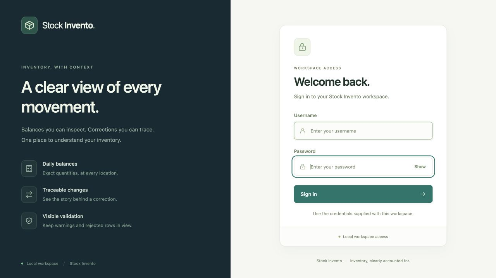

# Local login verification

**Result: PASS — username/password login and the full regression suite.** Reviewed on 28 October 2026 (India Standard Time).

The requested default account is **admin / admin123**. These details are prominent in `START_HERE.txt` and the portable guide inside the ZIP. The local review is available at `http://127.0.0.1:8768/login`; ordinary packaged startup uses port 8765 unless another port is chosen.

## What changed

A matching green sign-in page now protects the inventory workspace and its data/download APIs. The dashboard shows the signed-in account and a Sign out action. The application retains the existing inventory layout, samples, negative-stock warnings, correction workflow, and local-only execution.

The local account stores a random 32-byte salt and PBKDF2-HMAC-SHA-256 password hash with 600,000 iterations. Passwords are not stored as plaintext in the database. A successful login issues a new opaque session and a new CSRF token. The cookie is HttpOnly, SameSite=Strict, host-only, and specific to the server port. Server-side sessions expire after 30 minutes of inactivity or 8 hours in total. Sign out invalidates the used session; restarting the server invalidates every in-memory session.

Login needs a short-lived pre-login cookie/token plus the local Origin. Authenticated mutation requests still need their own session token and matching Origin. After five failed attempts from one client within 60 seconds, subsequent attempts receive 429 and a Retry-After interval until the window expires. Anonymous APIs return 401; the dashboard redirects to sign in. Restored browser-history pages revalidate with the server.

These choices use Python's standard library. The design references the [OWASP password-storage guidance](https://cheatsheetseries.owasp.org/cheatsheets/Password_Storage_Cheat_Sheet.html) and [session guidance](https://cheatsheetseries.owasp.org/cheatsheets/Session_Management_Cheat_Sheet.html); this report does not claim a full security certification.

## Executed results

| Layer | Observed result | Evidence |
| --- | --- | --- |
| Full Python regression suite | **117 methods**, 222 recorded subtest checks; 0 failures,0 errors,0 skips; 11.136807 seconds | [Per-test JSON](../evidence/authentication/python-tests.json), [JUnit](../evidence/authentication/junit.xml), [log](../evidence/authentication/unit-tests.txt) |
| Authentication cases | 14 new HTTP/manager tests covering authorization, credentials, cookies, CSRF/origin, rotation, logout, restart, exact expiry boundaries, hashing, exports, and throttling | [Authentication tests](../tests/test_auth.py) |
| Password CLI cases | 3 new tests covering hidden prompts, length/mismatch rejection, hash persistence, no password output, and no creation of a missing database | [Password CLI tests](../tests/test_password_cli.py) |
| Existing JavaScript helpers | 11 checks passed; both dashboard/login scripts also passed syntax checking | [Helper log](../evidence/authentication/ui-helpers.txt) |
| Browser workflow | 8 scenarios passed: redirect, masking, bad password, correct login, real import, logout, Back protection, and repeat sign-in/data retention | [Browser results](../evidence/authentication/browser-checks.json) |
| Portable workflow |Clean copied folder with spaces, different invoking directory, real login/import/replay/export, and login after restart all passed | [Portable proof](../evidence/authentication/portable-check.json) |

The 117 methods include all 100 prior regression methods with HTTP fixtures updated to authenticate, plus 17 new methods. Subtest/helper/browser counts are separate coverage measures and are not added into one test count. No skipped or unexecuted case is reported as passed.

The browser correction accepted one revision and retained four daily comparisons. Signing out and back in preserved 54 versions and the expected 85.000 closing balance. The user's separate review database retained its original 50-event demonstration.

The [earlier requirements campaign](test-report.md) remains historical evidence from before login. Its 100,000-record benchmark is unchanged pipeline evidence, not a new authentication benchmark. The authentication campaign's runtime/test hashes are in its JSON; the latest source verification is linked from the final package review; the ZIP manifest separately checks packaged-file integrity.



## Password management and scope

From the project root, use the selected database path:

```sh
python3 -m inventory set-password --db var/demo/inventory.db
```

Enter the new password twice at the hidden prompts, then restart the server to revoke existing sessions. New passwords must contain 8–1024 characters. Startup preserves a changed hash; it does not restore the default password. On Windows, use `py -3` where appropriate.

The shared defaults are intended for this local demonstration. The server stays on loopback and uses local HTTP; its cookies therefore do not carry the HTTPS-only Secure attribute. This adds a web access gate, not encryption of local database files. CLI/file access remains governed by the operating system. There is one admin account, no OAuth provider, public hosting, multi-user roles, or external identity dependency.

Runtime testing used macOS/arm64/Python 3.14.6; native Windows/Linux execution was not performed. The platform launchers and Python 3.10 grammar compatibility were checked. Follow the [portable setup guide](portable-setup.md) for copying, startup, password changes, data persistence, and backups.

To reproduce the suite without overwriting the supplied reports:

```sh
python3 scripts/run_tests.py --out var/authentication-tests-new
```
