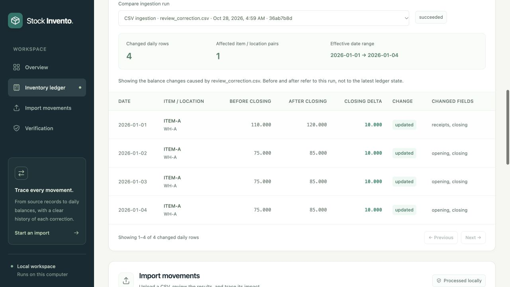

# Stock Invento — requirements verification report

**Historical pre-authentication campaign.** This report records the implementation before the subsequent username/password login change. Its 100-method result remains historical evidence; it is not the final verification of the added authentication feature. The [current authentication supplement](auth-test-report.md) records the later 117-method/222-subtest campaign, eleven JavaScript helper checks, eight browser scenarios, and authenticated portable verification separately.

**Result: PASS for the tested local application and supplied implementation criteria.**

Reviewed on **28 October 2026 (India Standard Time)**. This report was generated only after the final automated, browser, reconciliation, and copied-package checks passed. The original requirements were reviewed against the implementation; the [scenario and requirements matrix](test-scenarios.md) maps all ten implementation steps, nine required negative categories, seven acceptance criteria, and five deliverable groups. It distinguishes executed behavior from documentation inspection and external actions.

## Executed results

| Verification layer | Result | Evidence |
| --- | --- | --- |
| Complete Python suite | **100 test methods passed**, with **196 recorded subtest checks**; 0 failures, 0 errors, 0 skips; 5.579 seconds | [Per-test JSON](../evidence/rigorous/python-tests.json), [JUnit XML](../evidence/rigorous/junit.xml), [full log](../evidence/rigorous/unit-tests.txt) |
| JavaScript helpers | **11 checks passed**: 6 asynchronous report-queue cases and 5 example-toggle cases | [Helper log](../evidence/rigorous/ui-helpers.txt) |
| Real browser workflow | **15 scenarios passed** using file selection, previews, form imports, tabs, disclosure controls, and CSV download | [Observed browser results](../evidence/rigorous/browser-checks.json), [filtered CSV](../evidence/rigorous/filtered-export.csv) |
| Independent balance reference model | **85 published states** compared with an independently written integer stock-transition oracle, including six fixed random seeds | [Business acceptance source](../tests/test_inventory_acceptance.py), per-test results above |
| Larger workload | **100,000 source records** ingested/reconciled in **4.832275 seconds**; all 15 reconciliation checks passed | [Performance](../evidence/rigorous/performance.json), [coverage](../evidence/rigorous/generator-coverage.json) |
| Replay of larger workload | Identical business balances, 0 newly accepted versions, 0 retained business changes; 4.884465 seconds | Same performance report |
| Portable launch and persistence | Clean copied path containing spaces, different invoking working directory, actual local HTTP correction/replay, export, and persistent restart passed | [Portable results](../evidence/rigorous/portable-check.json) |

The 196 subtests are parameterized checks inside the 100 methods, not 196 additional test methods. The 85 oracle states and 15 browser scenarios are also distinct coverage measures; these numbers are not added into one inflated test count. JavaScript/Node is optional developer verification and is not required to run the application.

## What the requirement review established

- The source and target schemas document grain, keys, types, required values, relationships, derived quantities, and assumptions. Business event/revision keys and derived posting IDs are deterministic; each operational attempt intentionally gets a fresh run ID and ISO UTC timestamps.
- CSV ingestion validates row structure, references, exact decimal quantities, and movement rules. Rejected records retain the source filename, physical ending line, raw values, reason, and run ID. A malformed file-level structure fails explicitly and preserves the previous publication.
- Receipts, issues, transfers, and signed adjustments produce exact daily balances. Transfers conserve each item's quantity, daily openings carry forward, maximum valid revision controls corrections, and backdated replacements rebuild affected historical contributions.
- Duplicate replays do not multiply stock or immutable versions. Full replacement revisions can change date, item, type, source, and destination; cancellation and restoration preserve history. Late arrival does not replace a greater revision with an older one.
- Operational evidence exposes accepted, duplicate, rejected, rolled-back, input/output counts, timing, and failure reason. Completed-run row accounting is checked independently of current inventory counts.
- Source-to-posting mappings, daily equations and continuity, daily movement grain, per-item closing totals, and run accounting reconcile. Tests deliberately corrupt equal-and-opposite item values to show why a global checksum alone is insufficient.
- Synthetic starter inputs, hand-calculated answers kept separately, a 50-event interactive demo, a configurable larger seeded generator, recorded outputs, architecture/setup guidance, and design/optimization notes are supplied. Local execution uses Python's standard library without external credentials.

The complete criterion-to-test mapping and reproduction instructions are in [test-scenarios.md](test-scenarios.md). Expected-input failures count as passed scenarios only because their required quarantine, rollback, and audit assertions passed.

## Python suite breakdown

| Module | Test methods | Result |
| --- | ---: | --- |
| `test_changes.py` | 13 | Passed |
| `test_demo.py` | 14 | Passed |
| `test_interface_acceptance.py` | 11 | Passed |
| `test_inventory_acceptance.py` | 8 | Passed |
| `test_pipeline.py` | 30 | Passed |
| `test_reporting.py` | 2 | Passed |
| `test_resilience_acceptance.py` | 4 | Passed |
| `test_startup.py` | 7 | Passed |
| `test_web.py` | 11 | Passed |
| **Total** | **100** | **Passed** |

The rigorous campaign added 25 meaningful test methods beyond the prior 75: 8 independent business acceptance tests, 11 real CLI/HTTP acceptance tests, 4 resilience/ordering/numeric-boundary tests, and 2 reporting-tool reliability tests.

### Independent and failure tests

Six seeds (`3`, `17`, `42`, `73`, `101`, `2026`) each produce 82 events processed across eight shuffled batches. The reference model checks all seven quantity columns, negative flags, and per-item external-net conservation. Three revision-arrival orders exercise date/item/type/location/destination replacements, older revisions, voids, and restoration. Additional states verify negative carry-forward, obsolete-series removal, canonical duplicates/conflicts, and multi-account transfer rollback/retry.

A real child process was killed after replacement balances were built inside an uncommitted transaction. A concurrent WAL reader saw the entire previous publication. After restart, SQLite integrity and foreign-key checks passed; history, postings, reporting horizon, raw records, and retained changes had no half-committed replacement. Retrying accepted exactly the new versions; replay then produced only duplicates. The unfinished attempt remained visibly `running`, as documented, rather than being fabricated as successful.

Real subprocess CLI checks verified exit codes 0/2/1, JSON/report/export contracts, invalid/malformed inputs, state retention, and retry. HTTP tests verified malformed JSON/UTF-8/shapes, exact 10 MiB CSV boundaries including UTF-8 byte counts, token/origin/host guards, publication rollback, lock release, and competing-import rejection. A controlled real-writer barrier verified old-snapshot readers and the 409 response to a second browser writer. A separate commit during export verified that every exported table and JSON report retained the same earlier read snapshot.

The reporting tool itself was tested: failed reruns remove stale PASS JSON/JUnit/log artifacts, and successful runs write matching reports and clear an older failure log. Controlled failure inside that self-test is expected test input; the enclosing acceptance test passed.

## Fresh 100,000-record measurement

| Measure | Observed value |
| --- | ---: |
| Physical source records | 100,000 |
| Newly accepted immutable versions | 98,230 |
| Duplicate source rows | 990 |
| Deliberately invalid/quarantined rows | 780 |
| Current event keys | 98,034 |
| Published daily rows | 71,839 |
| Negative daily rows | 35,888 |
| Ingestion and reconciliation | 4.832275 s |
| Replay | 4.884465 s |

98,230 + 990 + 780 accounts for all 100,000 inputs. Current events are fewer than historical versions because 196 accepted versions are later revisions. Daily rows have a different grain from events. Negative balances are permitted, flagged accepted-data conditions; they are separate from the 780 excluded invalid records. All 15 mathematical checks passed with these warnings present.

Generator version 2 with seed 42 covered all four movement types and all eight source locations for every one of the 100 items. Coverage metadata and expected answers remain outside movement input columns. This is one measurement on macOS/arm64/Python 3.14.6, not a capacity guarantee or speedup claim. The earlier 4.60-second benchmark remains separately recorded under `evidence/performance.json`; this campaign's fresh measurement is under `evidence/rigorous/`.

The documented next optimization is to rebuild only affected item/location/date partitions while preserving atomic publication. The current complete rebuild favors a simpler correctness model; long horizons and growing histories increase cost.

## Browser observations

The isolated browser workspace began with 50 events, 53 versions, 47 daily rows, 3 deliberate rejects, and 4 negative balance rows. A real correction upload accepted one revision and retained four before/after rows: 110.000 to 120.000 on January 1, and 75.000 to 85.000 on January 2–4. Replaying it returned one duplicate and zero business changes.

The supplied [mixed browser fixture](../data/qa/browser_mixed.csv) then accepted one valid 0.001 receipt and quarantined one invalid HTML-like event ID. Quarantine displayed that payload as literal text and created no image element. A subsequent bad-schema upload exposed its failure reason and left the published ledger unchanged. All 15 reconciliation checks still passed. The resulting 51-event test database is separate from the user's 50-event review demo.

The custom shortage filter survived opening and closing the example. The actual CSV download contained exactly four ITEM-D/WH-C rows with closings `30.250`, `-9.875`, `-14.000`, and `-14.000`. Failure details and all 55 revision-history rows remained inspectable, including the superseded void version. Both bottom disclosures opened and closed; keyboard Enter worked for the process guide. No captured warning/error logs or document-level overflow appeared at the observed 1280 CSS-pixel viewport.



## Findings fixed before the passing report

| Finding | Fix | Regression evidence |
| --- | --- | --- |
| Runs sharing a timestamp could disagree about the latest attempt | Report and latest-impact selection use the same insertion-order tie-break | `test_same_millisecond_runs_share_one_latest_audit_order` |
| SQLite could promote an overflowing intermediate daily-equation expression to floating point | Equation verification uses exact Python integers, matching publication arithmetic | `test_daily_equation_remains_exact_when_intermediate_sum_exceeds_int64`, both signs and one-thousandth corruption detection |
| An older PASS test report could remain after a failed rerun | Generated PASS artifacts are invalidated for the new invocation; successful output clears an old failure log | Both methods in `test_reporting.py` |

No unresolved defect in the mandatory local implementation was identified after these fixes and the final checks.

## Reproduce the evidence

From the extracted project root, choose an unused output folder:

```sh
python3 scripts/run_tests.py --out var/review-tests
python3 scripts/verify.py --rows 100000 --out var/review-verification
```

Use `py -3` instead of `python3` on Windows where appropriate. The first command writes per-test JSON, JUnit XML, and text evidence only on a clean pass. The second also checks the independent sample oracles, correction impact, larger workload, reconciliation, and replay. Writing under `var/` preserves the shipped campaign evidence. Optional Node verification is `node tests/ui_refresh.test.cjs`. The browser sequence is reproducible through the scenario matrix and `data/qa/README.md`.

## Scope and limitations

- Runtime execution used macOS/arm64 and Python 3.14.6. Python 3.10 grammar compatibility was checked for 23 Python files. Windows/Linux launchers were syntax/argument reviewed; native Windows/Linux execution and every Python/browser version were not tested.
- Browser observations used one macOS in-app browser at 1280 CSS-pixel width. This is functional evidence, not a complete accessibility, penetration, load, or all-device certification.
- Hard termination can leave an unfinished audit attempt for operator investigation. It does not automatically become a completed failure, and the tests do not claim otherwise.
- This is a local single-writer workflow. There is no public-hosting, multi-user authorization, valuation, unit-conversion, or distributed-scale promise.
- Public GitHub publication and external assessment submission remain outside this local ZIP delivery, as requested. Candidate understanding and personal review must be completed by the candidate; automated testing cannot establish them.

The ZIP contains the implementation and independently generated scenario/evidence files, not private email, private account details, assessment PDFs, private credentials, or a copy of the confidential source brief. The later shared demonstration login `admin` / `admin123` is intentionally documented at the user's request; generated workspace credential data and cookies are excluded. The source/test hashes in this campaign's per-test JSON identify its historical verified code. The archive's SHA-256 manifest checks transferred file integrity separately from application correctness.
