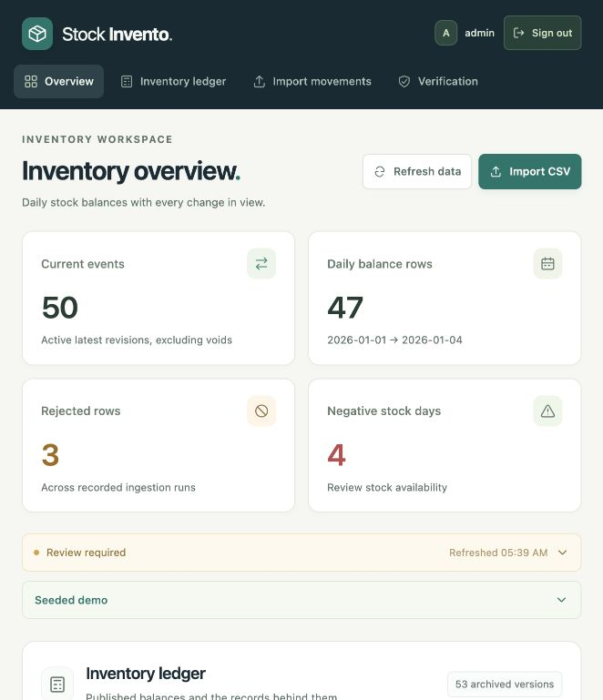

# Compact guidance and dynamic status

Latest update: the [import drawer and requirements verification](import-drawer-test-report.md) records the single import action, 14 browser scenarios, a final-source regression rerun, and another 100,000-row verification. Earlier measurements below retain their original scope.

The six report tabs now show a simple **Demo example** disclosure, collapsed by default. Its explanation and existing action remain inside. **Seeded demo**, **Review required**, and **Valid rows commit. Invalid rows go to quarantine.** are also collapsed disclosures. Review required and Seeded demo are below the four metric cards, before Inventory ledger. The status heading appears once.

Native controls support click and Enter; open state survives refresh and tab navigation. View/Close example, receipt correction, and recovery comparisons were checked in the browser. The workspace retained 50 events, 47 daily rows, 3 intentional rejects, and 4 negative balance rows.

The status is data-driven. In a separate clean workspace, actual imports produced these observed transitions:

| Input/state | Status | Warning details |
| --- | --- | --- |
| No runs yet | Ready | No pipeline runs |
| Valid receipt of 10 | Up to date | 15 reconciliation checks passed |
| Issue of 12 | Review required | 3 negative daily balances |
| Replace the issue with revision 2, quantity 5 | Up to date | Negative balances cleared |
| Receipt with an unknown item | Review required | 1 rejected source row |

Failed reconciliation or ingestion attempts also trigger review. Rejections and failed runs are retained audit history, so later successful imports do not erase those records. A connection failure uses the separate **Connection unavailable** state.

Verification passed: **117 Python methods**, **222 subtest checks**, zero failures/errors/skips, in 10.999890 seconds; **11 existing JavaScript helper checks** also passed. No new unit tests were written for this presentation change. See the [per-test JSON](../evidence/ui-disclosures/python-tests.json), [JUnit](../evidence/ui-disclosures/junit.xml), [log](../evidence/ui-disclosures/unit-tests.txt), [JavaScript results](../evidence/ui-disclosures/ui-helpers.txt), and [browser observations](../evidence/ui-disclosures/browser-checks.json). Source hashes identify the final verified runtime and test files.

The [authentication report](auth-test-report.md) and earlier [requirements campaign](test-report.md) remain separate recorded campaigns. Login credentials and startup instructions remain in START_HERE.txt.

